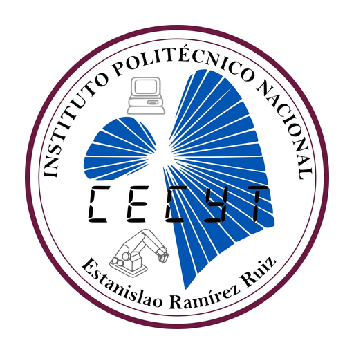
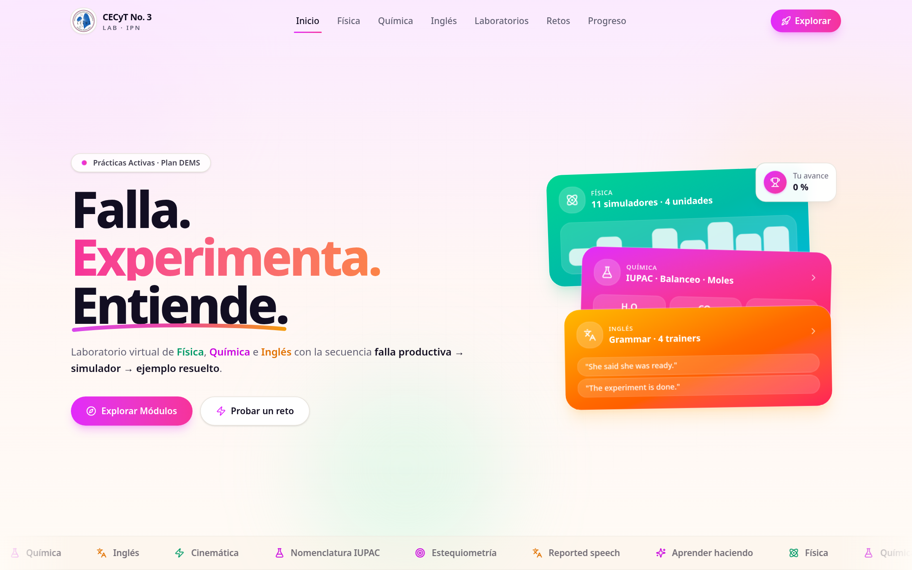
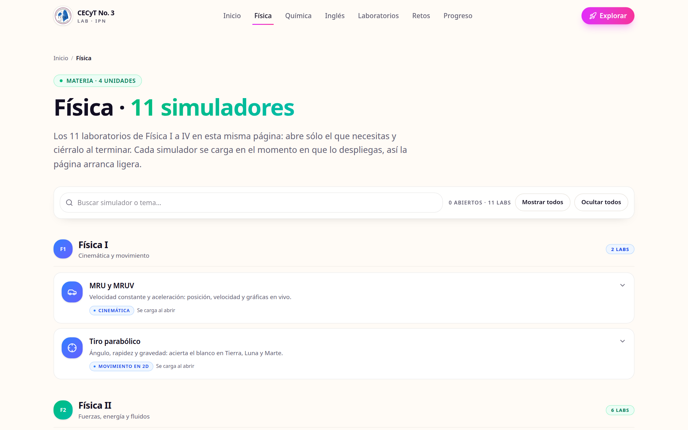
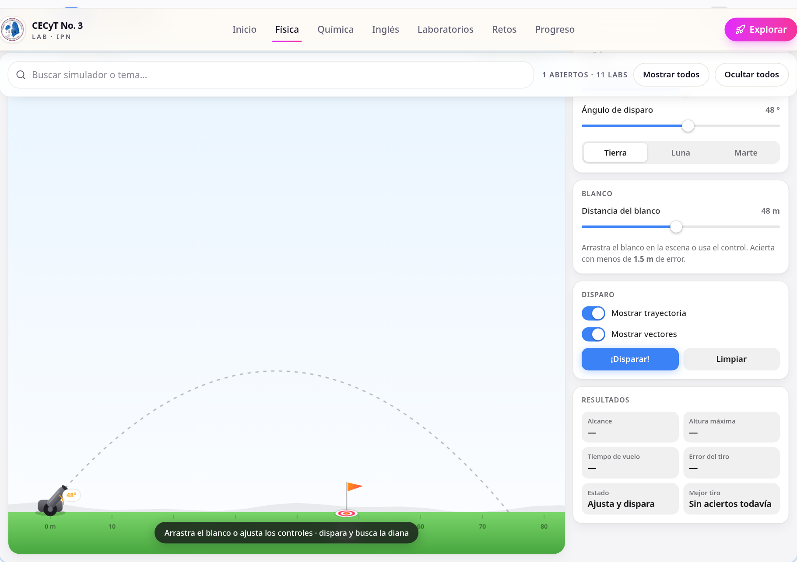
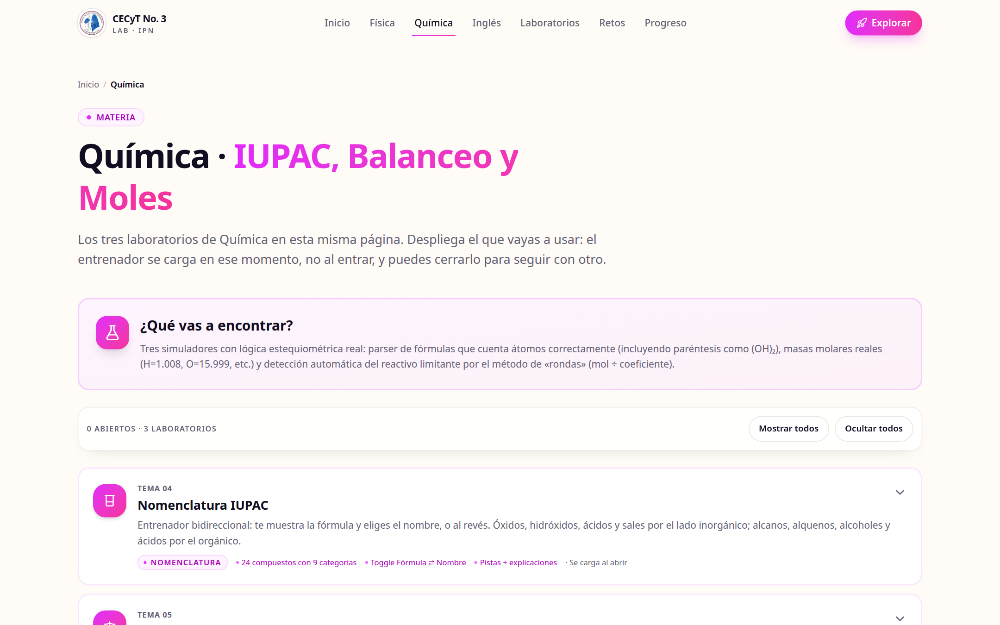
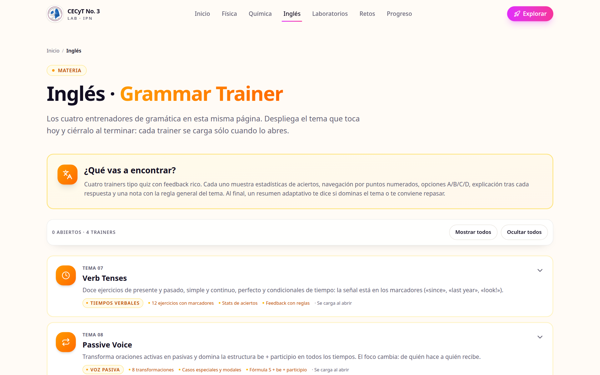

<div align="center">



# CECyT 3 Lab

**Laboratorio virtual de Física · Química · Inglés**
CECyT No. 3 «Estanislao Ramírez Ruiz» — IPN

*Falla. Experimenta. Entiende.*

[](https://cecyt3-lab.vercel.app)
[](https://github.com/villaralan11/CECyT-3-Lab/actions/workflows/ci.yml)
[](./LICENSE)



</div>

Plataforma web con **18 laboratorios interactivos** para el tronco común del CECyT 3. Cada tema sigue la misma secuencia didáctica: el alumno **falla primero**, manipula un **simulador** y cierra con un **ejemplo resuelto** que se auto-explica (Kapur, falla productiva · Renkl, worked examples).

## Qué incluye

| Materia | Laboratorios | Contenido |
|:--|:--:|:--|
| **Física** | 11 | F1 cinemática · F2 fuerzas y energía · F3 electricidad · F4 ondas |
| **Química** | 3 | Nomenclatura IUPAC · Balanceo · Estequiometría con reactivo limitante |
| **Inglés** | 4 | Verb tenses · Passive voice · Modal verbs · Reported speech |

**Física I–IV (11 simuladores):** MRU/MRUV · tiro parabólico · fuerzas y movimiento · colisiones · energía del patinador · resortes y masas · flotabilidad · gases · cargas y campo · ley de Ohm · ondas en cuerda. Los simuladores son HTML autónomos en canvas (`public/simuladores/`), con planetas, blanco arrastrable y lecturas en vivo.

## Capturas

<table>
<tr>
<td width="50%"></td>
<td width="50%"></td>
</tr>
<tr>
<td width="50%"></td>
<td width="50%"></td>
</tr>
</table>

## Stack

Next.js 16 (App Router) · React 19 · TypeScript 5 · Tailwind CSS 4 · shadcn/ui · Prisma (opcional) · HTML5 canvas para los simuladores. Tipografía única **Noto Sans**, empaquetada con el sitio (`public/fonts/`).

```
public/simuladores/   simuladores autónomos (HTML + canvas + base.js + estilo.css)
src/app/              rutas: /, /fisica, /quimica, /ingles, /laboratorios, /retos, /progreso
src/components/       navbar, footer, UI y componentes didácticos
docs/                 product charter, roadmap, WBS, guía docente, capturas
```

## Correr en local

```bash
git clone https://github.com/villaralan11/CECyT-3-Lab.git
cd CECyT-3-Lab
npm install
npm run dev        # http://localhost:3000
npm run build      # build de producción
npm run lint
```

Sin base de datos configurada, el progreso se guarda en `localStorage`.

## Publicación

El sitio se publica en **Vercel** (<https://cecyt3-lab.vercel.app>) desde `main`: cada push despliega producción y cada PR genera una vista previa.

## Documentación

- [Acta de constitución](./docs/PROJECT_CHARTER.md) · [Roadmap](./docs/ROADMAP.md) · [WBS](./docs/WBS.md)
- [Guía del profesor](./docs/guia-profesor.md) · [Informe del piloto](./docs/informe-piloto.md) · [Plan de Fase 2](./docs/plan-fase2.md)
- [Índice completo de documentación](./docs/README.md)

## Ramas y versiones

Una sola rama activa: **`main`**. Las versiones anteriores quedaron archivadas como etiquetas, sin ramas paralelas:

```bash
git tag                      # archivo/*, v0.2.1-alan
git show archivo/v0.3.0      # versión del equipo (docs, scripts, entrenadores)
```

## Créditos

Proyecto académico del **CECyT No. 3 «Estanislao Ramírez Ruiz» — IPN**.
Coordinación y dirección: **Victor Eduardo Rivera Corona** · Desarrollo: **Alan Antonio Molina Villar**, **Isai Rodríguez Villaseca**.

MIT — ver [LICENSE](./LICENSE).
