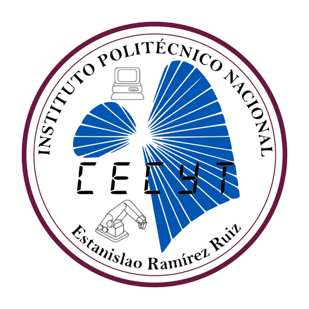
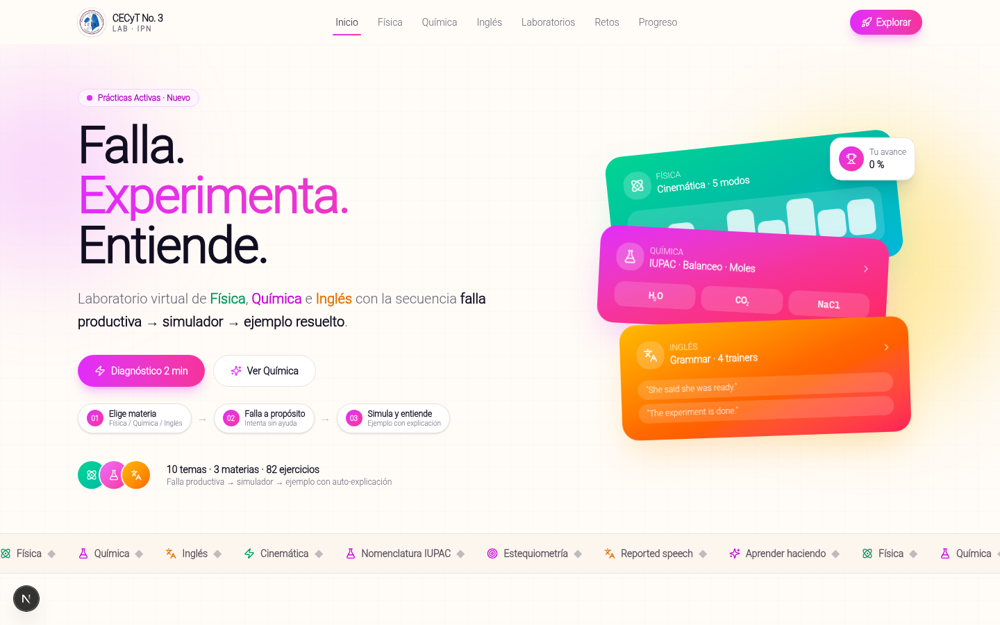
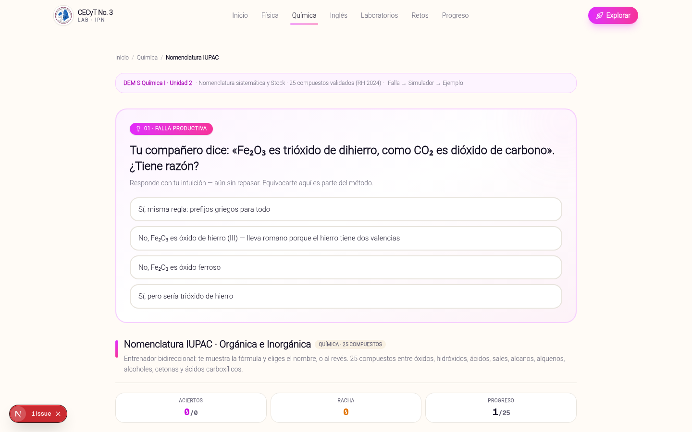
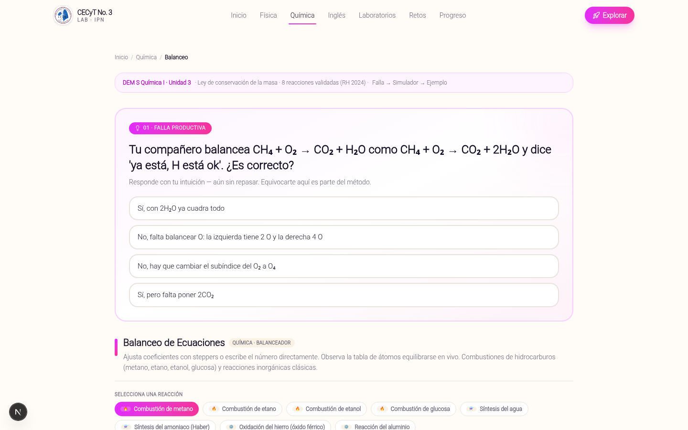
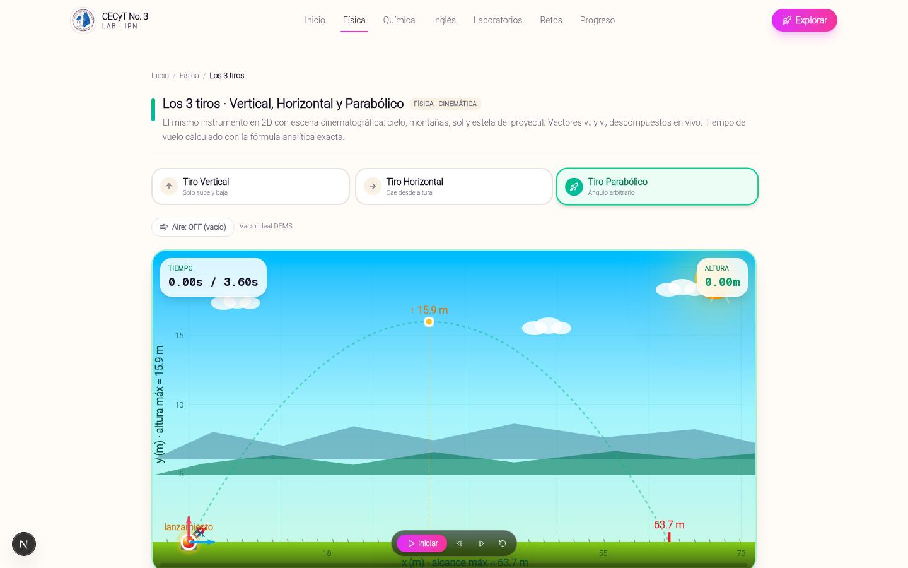

<div align="center">
  
  
  # CECyT 3 Lab
  
  ### Laboratorio Virtual de Física · Química · Inglés
  
  **CECyT No. 3 "Estanislao Ramírez Ruiz" — IPN**
  
  *Falla. Experimenta. Entiende.*

  [](https://cecyt3-lab.vercel.app)
  
  ---
  
  <div>
    
    
    
    
    
  </div>
</div>

---

## 🎯 Sobre el Proyecto

Plataforma educativa interactiva diseñada para mejorar el aprendizaje en **Física**, **Química** e **Inglés** siguiendo una secuencia didáctica probada:

1. **Falla Productiva** — Experimenta sin límites y comete errores
2. **Simulador** — Visualiza y manipula conceptos en tiempo real  
3. **Ejemplo Resuelto** — Auto-explicación paso a paso

Basado en investigación educativa: *Kapur (falla productiva)* y *Renkl (worked examples)*.

---

## 🚀 Características Principales

### Física (3 módulos)
- **MRU · MRUV · Tiros** — Simulación Euler-Cromer con Δt=1/120s
- Gráficas x-t y v-t en vivo
- Toggle de resistencia al aire: F = -k·v·|v|

### Química (3 módulos)
- **IUPAC (Stock)** — 25 compuestos + visor 3D con 3Dmol
- **Balanceo de ecuaciones** — 8 ejercicios + solver dinámico
- **Estequiometría** — Masas molares reales + reactivo limitante

### Inglés (4 módulos)
- **Verb Tenses · Passive · Modals · Reported Speech**
- Preguntas de opción múltiple + escritura libre tolerante
- Validación inteligente (I'm = I am, ignora puntuación)

### Sistema de Progreso
- **Quiz de 6 preguntas** con explicación en 3 pasos
- **Niveles:** Novato → Experto
- **Sincronización:** localStorage (local) + API (nube opcional)

---

## 📸 Galería

<table>
<tr>
<td width="50%"></td>
<td width="50%"></td>
</tr>
<tr>
<td width="50%"></td>
<td width="50%"></td>
</tr>
</table>

---

## 🛠️ Stack Tecnológico

| Categoría | Tecnologías |
|-----------|-------------|
| **Frontend** | Next.js 16 · React 19 · Tailwind CSS 4 · shadcn |
| **Animación** | Framer Motion |
| **Backend** | Prisma · PostgreSQL (Supabase) |
| **Visualización** | 3Dmol (química 3D) |
| **Testing** | Vitest · Playwright |
| **Tipado** | TypeScript 5 |

---

## 📁 Estructura del Proyecto

```
.
├── src/                    # Aplicación Next.js (App Router)
│   ├── app/                # Páginas y API (/api/progress)
│   ├── components/         # UI, simuladores, didáctica y visor 3D
│   ├── hooks/
│   └── lib/                # Utilidades + tests Vitest
├── public/simuladores/     # Simuladores HTML/JS por materia
├── prisma/                 # Esquema de base de datos
├── data/                   # Plantillas CSV del piloto
├── docs/
│   ├── producto/           # Gestión: charter, roadmap, WBS, informe piloto
│   ├── guias/              # Material para docentes y consentimiento
│   ├── desarrollo/         # Sistema de diseño y notas técnicas
│   └── screenshots/        # Capturas de las 3 versiones
├── scripts/
│   ├── analisis-piloto.py  # Análisis estadístico del piloto
│   └── deploy/             # Scripts de despliegue del sandbox
└── tests/                  # Pruebas de los scripts de despliegue
```

---

## ⚡ Inicio Rápido

### Instalación

```bash
# Clonar repositorio
git clone https://github.com/villaralan11/CECyT-3-Lab.git
cd CECyT-3-Lab

# Instalar dependencias (npm es el gestor oficial: ver package-lock.json)
npm ci

# Configurar variables de entorno (opcional)
cp .env.example .env.local
# Edita .env.local con tu DATABASE_URL de Supabase
```

### Desarrollo

```bash
# Servidor local
npm run dev
# Abre http://localhost:3000

# Tests
npm test              # Vitest (38 tests)
npm run test:coverage # Cobertura (requiere @vitest/coverage-v8)

# Linting
npm run lint

# Build producción
npm run build
npm start
```

**Nota:** Sin Supabase configurado, la app funciona completamente en local con `localStorage`.

---

## 🎨 Diseño

Sistema de colores por materia:

| Materia | Paleta |
|---------|--------|
| **Física** | Emerald: 50 / 700 / 200 |
| **Química** | Fuchsia: 50 / 700 / 200 |
| **Inglés** | Amber: 50 / 700 / 200 |

**Tokens:** Radius 16px (cards), full (pills) · Touch targets 44px · WCAG AA · Tipografía: Geist Sans + Mono

Ver detalles completos en [`docs/desarrollo/DESIGN.md`](./docs/desarrollo/DESIGN.md)

---

## 📚 Documentación

Índice completo en **[docs/README.md](./docs/README.md)**.

- **[Charter](./docs/producto/PROJECT_CHARTER.md)** — Objetivos, alcance y riesgos
- **[Roadmap](./docs/producto/ROADMAP.md)** — Sprints e hitos
- **[WBS](./docs/producto/WBS.md)** — Estructura de desglose del trabajo
- **[Sistema de diseño](./docs/desarrollo/DESIGN.md)** — Tokens, componentes y accesibilidad
- **[Guía del profesor](./docs/guias/guia-profesor.md)** — Manual para docentes
- **[Informe del piloto](./docs/producto/informe-piloto.md)** — Resultados + análisis t-test y Cohen d
- **[Scripts](./scripts/README.md)** — Análisis del piloto y despliegue

---

## 🏆 Versiones Anteriores

```bash
git checkout v1-azul      # Diseño original en azul
git checkout v2-linear    # Rediseño Linear Dark
git checkout v3-actual    # Versión actual
```

Ver todas las capturas en [`docs/screenshots/`](./docs/screenshots/)

---

## 📊 Estadísticas

- **TypeScript:** 92.2% · **Shell:** 5.9% · **Other:** 1.9%
- **38 tests** con Vitest
- **10 módulos** interactivos (3 Física + 3 Química + 4 Inglés)

---

## 🤝 Contribuir

Las contribuciones son bienvenidas. Por favor:

1. Fork el repositorio
2. Crea una rama: `git checkout -b feature/mi-mejora`
3. Commit: `git commit -m "Agrega mi mejora"`
4. Push: `git push origin feature/mi-mejora`
5. Abre un Pull Request

---

## 📄 Licencia

MIT License — Libre para usar, modificar y distribuir.

---

<div align="center">
  <p><strong>Hecho por Alan Villar</strong></p>
  <p>CECyT No. 3 "Estanislao Ramírez Ruiz" — IPN</p>
  <p><a href="https://cecyt3-lab.vercel.app">🚀 Ver en vivo</a> · <a href="https://github.com/villaralan11/CECyT-3-Lab">📖 Ver código</a></p>
</div>
